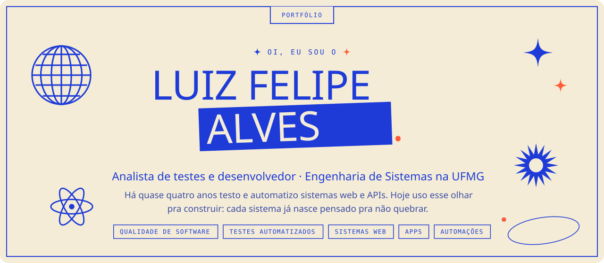

### Projetos

| Projeto | O que é | Onde ver |
| --- | --- | --- |
| **EasyHelp** | App mobile + web · TCC · Engenharia de Sistemas UFMG · 2026 | [easyhelphome.app.br](https://easyhelphome.app.br) |
| **Oficina de motos** | Site + WhatsApp · Moto peças e serviços · 2026 | [na galáxia do site](https://www.salltech.com.br/#trabalhos) |
| **Atendimento automático** | Automação + IA · Clínica odontológica · 2026 | [na galáxia do site](https://www.salltech.com.br/#trabalhos) |
| **Gestão de entregas** | Sistema web · Empresa de entregas · 2026 | [na galáxia do site](https://www.salltech.com.br/#trabalhos) |
| **R-Type** | Jogo desktop · Desenvolvimento de Software · UFMG · 2022 | [código](https://github.com/lfelipesal/R-type) |
| **Gestão de portfólios** | Otimização financeira · Pesquisa Operacional · UFMG · com Hiago Celestino e Daniel Araújo · 2025 | [código](https://github.com/lfelipesal/Pesquisa_Operacional_UFMG) |

### Testes automatizados

- [TesteAPI_JavaRestAssured](https://github.com/lfelipesal/TesteAPI_JavaRestAssured): testes da API Petstore com Java, RestAssured e JUnit
- [testAut-Cypress](https://github.com/lfelipesal/testAut-Cypress): teste de interface com Cypress numa loja online, do carrinho até antes de fechar a compra
- [Teste_Wisely](https://github.com/lfelipesal/Teste_Wisely): testes automatizados do projeto Wisely, em Java

### Contato

[LinkedIn](https://www.linkedin.com/in/lfelipesal) · [salltech.com.br](https://www.salltech.com.br)
